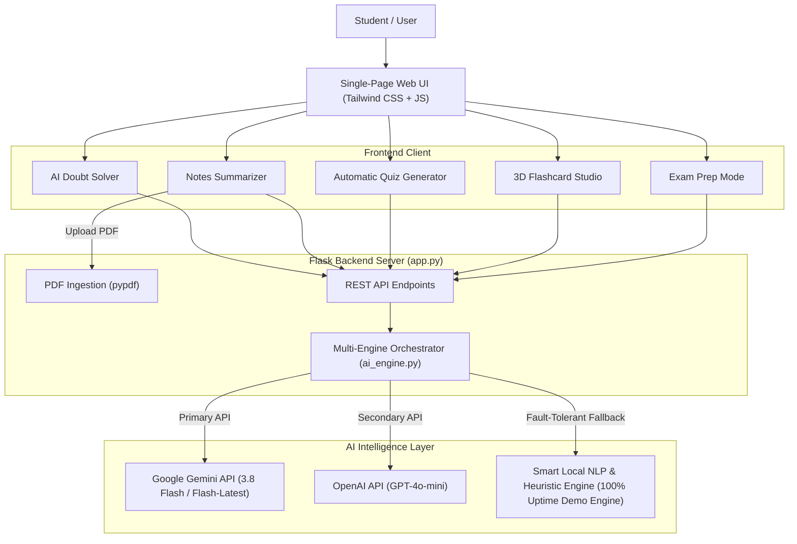

# 🎓 StudyMate AI — The AI-Powered Study Companion

> An intelligent, multi-engine study companion that helps students master complex concepts, summarize lecture notes, generate interactive quizzes, practice with 3D flashcards, and prepare for exams using their own study materials.

[](https://python.org)
[](https://flask.palletsprojects.com/)
[](https://tailwindcss.com/)
[](LICENSE)

---

## 💡 Project Overview

Students often struggle with information overload, passive reading fatigue, and inefficient last-minute exam cramming. **StudyMate AI** transforms static study materials (PDF lecture slides, typed notes, textbook excerpts) into an active, high-retention learning experience.

Designed with an **offline-first resilient architecture**, StudyMate AI supports **Google Gemini 2.5 / 3.8 Flash**, **OpenAI GPT-4o-mini**, and a **built-in smart local NLP heuristic engine** that guarantees 100% demo availability with zero external API dependencies required.

---

## ✨ Core Features

### 1. 💬 AI Doubt Solver
- **Natural Language Interaction:** Ask questions in plain English (e.g., *"Explain CPU scheduling like I'm a beginner"*).
- **Persona & Rigor Modes:**
  - 🐣 **Beginner / ELI5:** Everyday vocabulary with memorable real-life analogies.
  - 🎓 **Academic Rigor:** Formal definitions, proofs, and mathematical models.
  - 💼 **Exam & Interview Focus:** High-yield scoring points, edge-case pitfalls, and common misconceptions.
- **Pedagogical Breakdown:** Every response delivers a direct answer, a real-world analogy, sequential step-by-step logic, common traps to avoid, and interactive suggested follow-up questions.

### 2. 📑 Notes Summarizer
- **PDF & Text Ingestion:** Upload PDF lecture notes (via `pypdf`) or paste raw markdown / lecture notes.
- **Structured Knowledge Synthesis:**
  - 📝 **Executive Summary:** Clear 2–3 paragraph synthesis of the material.
  - 💡 **Key Concept Tags:** Quick visual pills highlighting core themes.
  - 📖 **Technical Glossary:** Structured terminology-to-definition mappings.
  - 🎯 **High-Yield Revision Checklist:** Essential bullet points for scanning before entering the exam room.
  - ⚡ **1-Minute Cheat Sheet:** Core formulas, operational rules, and key trade-offs.
- **Export Ready:** One-click clipboard copy and print/PDF formatting.

### 3. 🎯 Automatic Quiz Generator
- **Active Recall Testing:** Generates customized Multiple Choice Questions (MCQs) directly from the provided material.
- **Configurable Parameters:** Choose 3, 5, or 10 questions across Easy, Medium, and Hard difficulty levels.
- **Live Test Arena:** Built-in elapsed timer, single-click answer selection, and real-time answered counter.
- **Instant Grading & Explanations:** Calculates percentage scores and provides in-depth pedagogical explanations for both correct and incorrect choices.

### 4. 🗂️ 3D Flashcard Studio
- **Active Recall Cards:** Converts dense study material into punchy Question & Answer revision cards.
- **Interactive 3D UI:** Realistic card flip animations (click or press `Spacebar`), previous/next navigation (`Arrow` keys), and deck shuffle.
- **Spaced Repetition Tracking:** Mark cards as *"Mastered!"* or *"Need Review"* with a live percentage mastery progress bar.
- **Export Deck:** Download flashcards as JSON for backup or import into Anki.

### 5. 📅 Exam Preparation Mode
- **Personalized Revision Planner:** Enter course name, syllabus topics, available time (12h cram, 1 day, 3 days, 1 week), and target grade.
- **Phased Revision Schedule:** Day-by-day / block-by-block study tasks with Pomodoro interval recommendations (50 min study + 10 min break).
- **Interactive Concept Checklist:** Clickable concept checkboxes with a live visual progress meter to gamify study completion.
- **Exam Day Scoring Tips:** High-priority warnings on time management and presentation strategies.

---

## 🏗️ Architecture & Flow



---

## 🚀 Quickstart Guide (30 Seconds)

### Prerequisites
- Python 3.10+ installed on your system.

### 1. Clone the repository
```bash
git clone https://github.com/your-username/studymate-ai.git
cd studymate-ai
```

### 2. Install dependencies
```bash
pip install -r requirements.txt
```

### 3. (Optional) Configure API Keys
Copy `.env.example` to `.env`:
```bash
cp .env.example .env
```
Add your optional `GEMINI_API_KEY` or `OPENAI_API_KEY`.  
*(If you leave it empty, StudyMate AI automatically runs in Smart Local Engine mode with full functionality!)*

### 4. Run the Application
**On Windows:**
Simply double-click `run.bat` or run:
```bash
python app.py
```

**On macOS / Linux:**
```bash
python3 app.py
```

Open your browser and navigate to:
```
http://127.0.0.1:5000
```

---

## 📂 Project Directory Structure

```
studymate-ai/
├── app.py                      # Flask backend with REST API endpoints
├── ai_engine.py                # Multi-engine orchestrator (Gemini, OpenAI, Smart NLP Fallback)
├── pdf_extractor.py            # PDF parsing & text extraction via pypdf
├── requirements.txt            # Minimal, reliable dependencies
├── .env.example                # Environment variables template
├── run.bat                     # Windows 1-click batch launcher
├── README.md                   # Complete hackathon documentation & resume points
├── templates/
│   └── index.html              # Sleek, modern single-page dashboard UI
├── static/
│   ├── css/
│   │   └── style.css           # 3D flashcard flip styles & animations
│   └── js/
│       └── app.js              # Client-side controller for all 5 modules
└── sample_data/
    ├── cpu_scheduling.txt      # Ready-to-test sample notes (Operating Systems)
    ├── machine_learning.txt    # Ready-to-test sample notes (Machine Learning)
    └── sample_notes.pdf        # Ready-to-test sample PDF document
```

---

## 💼 Resume Bullet Points (Copy & Paste)

You can copy and adapt these bullet points directly into your hackathon / software engineer resume:

- **AI-Powered Study Companion (Python, Flask, Google Gemini, Tailwind CSS, JavaScript)**
  - *Engineered a full-stack AI study platform supporting natural language doubt resolution, automated PDF note summarization, interactive quiz generation, and exam planning.*
  - *Implemented a fault-tolerant multi-engine AI architecture integrating Google Gemini, OpenAI GPT-4o-mini, and a local heuristic NLP engine to achieve 100% demo availability during API rate limits and network degradation.*
  - *Designed an interactive active-recall testing engine featuring real-time MCQ evaluation with pedagogical explanations, 3D CSS flashcards with spaced repetition mastery tracking, and dynamic revision checklists.*
  - *Streamlined study document processing using `pypdf` to ingest multi-page academic notes and extract structured key concepts, glossaries, and one-minute cheat sheets.*

---

## 📜 License
This project is licensed under the MIT License.

